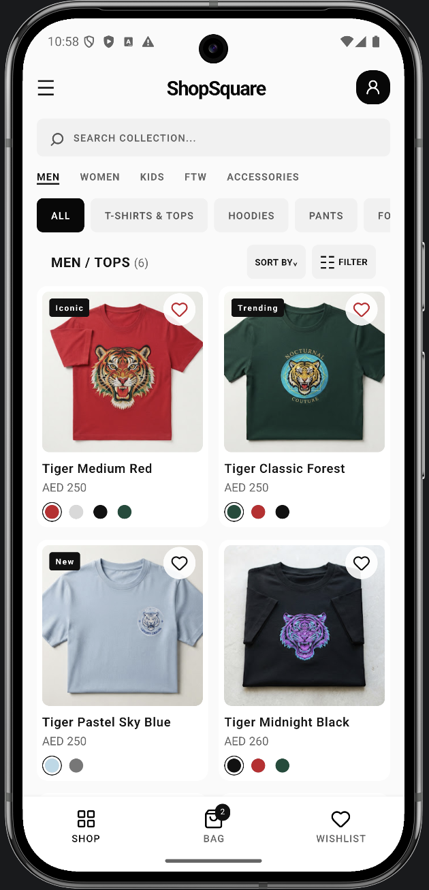
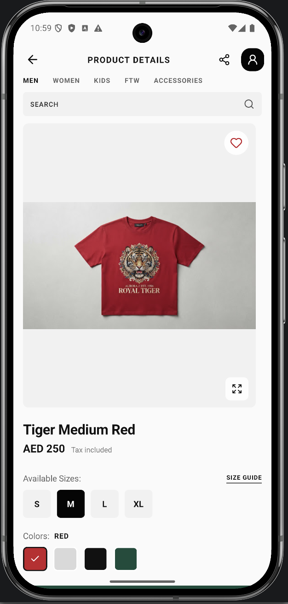
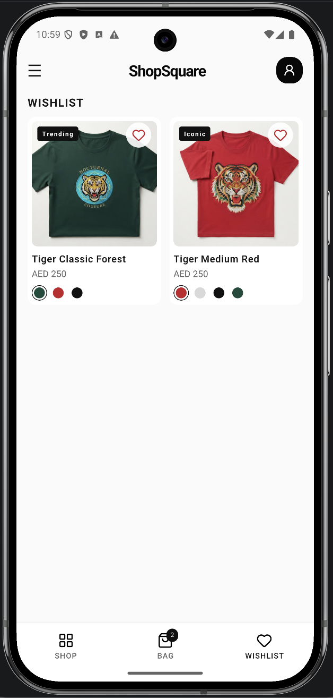
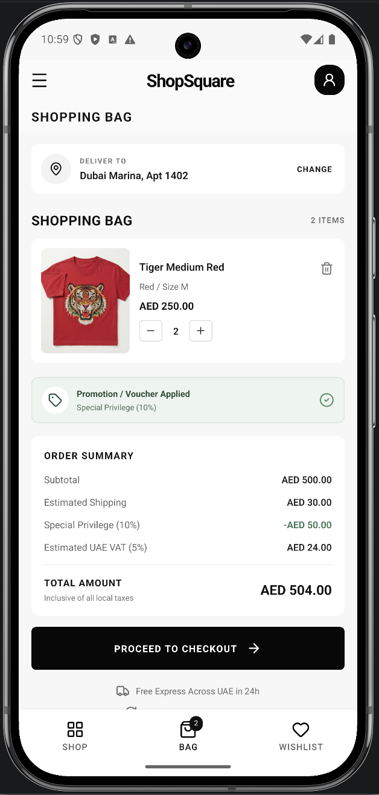
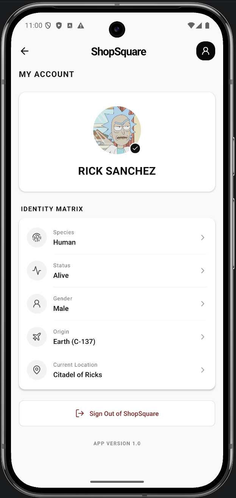

# ShopSquare

A React Native mobile app for browsing an online clothing store. The app currently includes a product catalog, product details, and separate Shop, Bag, and Wishlist tabs.

| Shop | Product details | Wishlist |
| --- | --- | --- |
|  |  |  |

| Shopping bag | My Account |
| --- | --- |
|  |  |

## Features

- Browse clothing by category, search the catalog, filter by size, and sort by price.
- Open a product details screen with size and color selection, description, size guide, and product imagery.
- Navigate between Shop, Bag, and Wishlist using bottom tabs.
- Add selected product variants to the Bag, manage item quantities, and review an order summary; the Bag tab badge reflects total quantity.
- Add and remove products from the Wishlist; both Bag and Wishlist are held in Redux for the current app session.

Bag and Wishlist state is not persisted between app launches.

## Tech stack

- React Native `0.87`
- React `19`
- TypeScript
- React Navigation (native stack and bottom tabs)
- Redux Toolkit and React Redux
- React Native Device Info
- React Native Safe Area Context
- Lucide icons

## Project structure

```text
src/
  app/navigation/        Root stack and bottom-tab navigation
  app/store/             Redux store, typed hooks, and slices
  features/
    cart/                Bag screen, model, and view model
    home/                Shop catalog, model, and view model
    myAccount/           My Account profile screen and API mapping
    productDetails/      Product details screen, model, and view model
    wishlist/            Wishlist screen, model, and view model
  service/               API client
  shared/
    components/          Reusable UI components
    constants/           API endpoints, static account and cart UI options, and store options
    models/              Shared TypeScript models
```

Feature code follows an MVVM-style organization with `model`, `viewModel`, and `view` folders. Reusable components and cross-feature constants belong in `src/shared`.

## Requirements

- Node.js `>= 22.11.0`
- npm
- Xcode and CocoaPods for iOS development
- Android Studio and Android SDK for Android development

Install JavaScript dependencies from the project root:

```sh
npm install
```

For iOS, install the native CocoaPods dependencies:

```sh
cd ios
bundle install
bundle exec pod install
cd ..
```

## Run the app

Start Metro in one terminal:

```sh
npm start
```

In another terminal, launch the app:

```sh
npm run ios
# or
npm run android
```

## Quality checks

```sh
npm run lint
npm test -- --runInBand
```

## Unit tests

The Jest suite covers unit-level behavior without running the app on a simulator
or device. The scenarios currently tested are:

| Area | Scenarios |
| --- | --- |
| API client | Returns JSON after a successful request; retries after a network error or a non-OK HTTP response; rejects with the final network error after three attempts; rejects after three non-OK responses. |
| Product API model | Calls the configured product API URL; returns valid product data; rejects a non-array response, a product missing required fields, and malformed color data. |
| Profile API model | Calls the configured profile API URL; maps name, image, status, species, gender, origin, and current location; rejects malformed profile data; maps identity detail rows and reads the installed app version. |
| Products Redux slice | Starts with an empty catalog and replaces it with the supplied products. |
| Wishlist Redux slice | Adds a product, removes it when toggled again, and preserves other products when removing one. |
| Cart Redux slice | Adds a selected variant; increments an existing matching variant; keeps different sizes and colors as separate lines; increments and decrements quantities; removes a line when quantity reaches zero; removes only the specified variant. |
| Cart summary | Returns zero values for an empty cart; calculates item count, subtotal, promotion discount, shipping, VAT, and total for one or multiple cart lines. |
| App smoke test | Renders the app entry point with the existing native-module mocks. |

Run all unit tests with:

```sh
npm test -- --runInBand
```

End-to-end tests and device/simulator interaction scenarios are not included yet.

## Product data

The Shop screen fetches the product catalog from the API configured in [`src/shared/constants/api.ts`](./src/shared/constants/api.ts) when it mounts. It stores the response in Redux using the existing `Product[]` shape; Shop filtering and Product Details read their data from Redux. Shared categories, departments, and apparel sizes are in [`src/shared/constants/storeOptions.ts`](./src/shared/constants/storeOptions.ts).

If the product API is unavailable, the request is retried and the Shop screen shows an error with an option to retry.

Note: EAS Build / EAS Update is not integrated as of now.

## Android build

The APK build is located at [`Builds/shopSquare.apk`](./Builds/shopSquare.apk).

## iOS build
The iOS project is included in the source code, but a shareable iPhone build is not provided because Apple signing and provisioning credentials are not configured.
